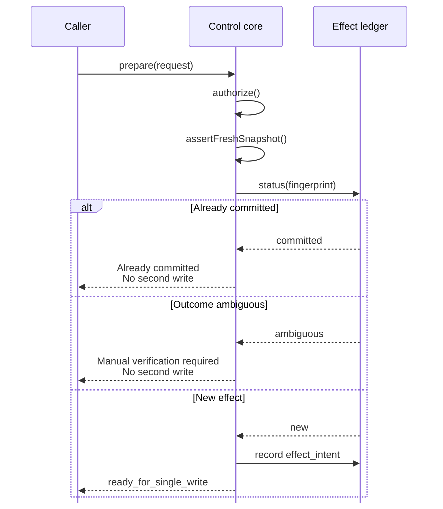
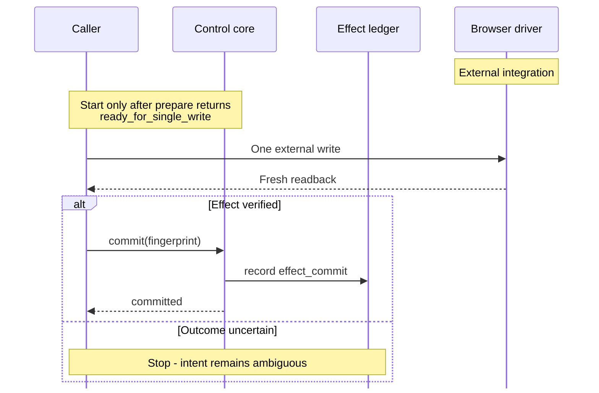

# Attended Browser Bridge

You click **Submit**. The page freezes. Did the request go through?

If you click again and it *did* go through, congratulations: you've discovered duplicates.

I built this JavaScript control core for that awkward gap between **"we tried"** and **"we know what happened."** It's the decision-making part of attended browser writes, not the browser driver.

## The one-write rule

A write goes through these checks:

1. **Permission:** Is this action allowed for this origin, and is the grant still valid?
2. **Fresh page:** Does the snapshot still match the origin, revision, age, and digest we inspected?
3. **Effect ledger:** Is this a new action, a previous success, or an unresolved attempt?

| Ledger says | The core says |
| --- | --- |
| New action | Record intent; one external write may be attempted |
| Previous attempt, outcome unknown | Stop. Verify first. |
| Already committed | Stop. The button had its moment. |

After the external caller performs the single write, a verified readback can commit it. With no trustworthy readback, the intent stays unresolved. A timeout doesn't magically erase history.

## The two halves of a write

First, the core checks permission and reserves intent *before* the external action.

Then the caller does a single write and verifies the result before recording success.

Node.js 20+, no browser session needed. [Verification steps](docs/verification.md) are kept out of this front page.

If you're reading the source, follow [`src/bridge.js`](src/bridge.js) → [`src/policy.js`](src/policy.js) → [`src/snapshot.js`](src/snapshot.js) → [`src/ledger.js`](src/ledger.js). The tests cover grants, snapshot freshness, effect fingerprints, and replay decisions. There's a more detailed [write-state table](docs/write-state-table.md) and a [timeout walkthrough](docs/walkthrough.md).

## Not a magic browser

This repository doesn't click websites. No Chrome transport, cookies, session secrets, or Kaggle connection are included. The caller still has to integrate the real browser, perform at most the permitted write, and check the external result.

I prefer a boring "manual verification required" to a very exciting duplicate form submission. See [SECURITY.md](SECURITY.md) and [PROVENANCE.md](PROVENANCE.md) for the boundary.
