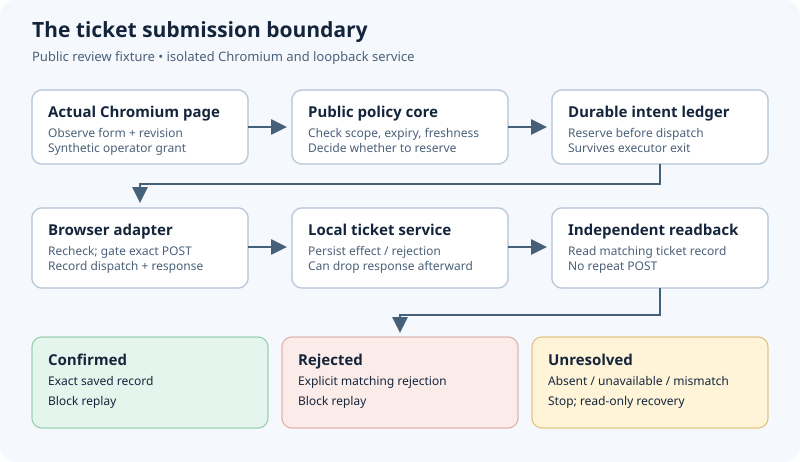

# Attended Browser Bridge

You click **Submit**. The page freezes. Did it go through? If you click again and it did, congratulations: you've discovered duplicates.

This public JavaScript control core separates permission, intent, dispatch, response and confirmed business outcome. The included **local Chromium demonstration** wires the actual public core to a synthetic support-ticket form. It is not a redistributable production browser agent or the private Browser Bridge implementation.



## Run the demonstration

Requirements: Node.js 20+, npm, a local filesystem and Chromium with its normal platform dependencies. No account, API key or customer data. In the extracted folder:

```sh
npm ci
npx playwright install chromium
npm test
npm run demo -- browser-evidence.json
```

On Linux, install required browser libraries if missing: `npx playwright install --with-deps chromium`. To use a compatible installed browser, set `CHROMIUM_PATH` to its executable (e.g. `CHROMIUM_PATH=/usr/bin/chromium npm run demo -- browser-evidence.json` on Linux; set `$env:CHROMIUM_PATH` in PowerShell). The command exits nonzero if any scenario fails. The test application binds to 127.0.0.1 on an ephemeral port.

## What the proof checks

| Situation | Expected decision | Server POSTs / saved tickets |
|---|---|---|
| Valid submit, then a repeated execution | Confirm after exact readback; suppress repeat | 1 / 1 |
| Explicit server rejection | Record rejection after matching readback, suppress repeat | 1 / 0 |
| 201 response but readback unavailable | Unresolved until a later matching readback | 1 / 1 |
| Server saves, connection breaks, executor exits before readback | Unresolved; restart does not submit again | 1 / 1 |
| Readback 503 or wrong payload, then matching readback | Remain unresolved; eventually confirm | Still 1 / 1 |
| Response lost before save, lookup returns absent | Remain unresolved; no blind retry | 1 / 0 |
| Stale form revision, expired grant, wrong origin | Deny before intent | 0 / 0 |
| Same-origin unexpected navigation, changed revision or expiry after intent | Hold for review, including after restart | 0 / 0 |

The suite defines 14 named scenarios across separate worker processes. It asserts counts from the fixture's fsynced server journal; a response code, an empty readback or a browser failure alone is not confirmation. The first process in the lost-response case exits deliberately with code 71 before reconciliation.

`npm test` exercises policy, snapshot, memory and durable ledger. `npm run demo` launches real Chromium and generates JSON containing initial UI state, worker PIDs, decisions, network response/failure, readback, journal phases and server-side counts. The JSON is generated only after all assertions pass. If recorded proof is included in a review archive, it is historical evidence; regenerate it yourself.

## Boundaries

- [Core](src/bridge.js): expiring origin/action grant, snapshot revision/age, stable effect fingerprint, intent and replay decision. `commit()` and `reject()` trust the caller's verification.
- [Durable journal](src/durable-ledger.js): exclusive reservations and fsynced records designed to survive executor restarts; unfinished reservation blocks replay; acknowledgment is separate from resolution.
- [Fixture adapter](examples/browser-worker.mjs): Playwright opens and fills the actual local form, rechecks permission and page state, gates one exact loopback POST, and reads back the business record separately.
- [Test site](examples/ticket-site.mjs): synthetic HTTP application with a persisted event log and deliberate response faults. [Runner](examples/verify-browser.mjs) launches fresh processes and checks server counters.

No actual customer session, production site, generic agent, private source, credential or session material is provided. The grant is a synthetic operator permission, not a real approval UI. Snapshot digests are deterministic integrity checks, not signatures. The fixture trusts its local readback and workspace; it targets executor restarts, not power loss, concurrent deployment, or recovery after journal deletion. Effect identity includes the submitted value; changing a payload can create a different fingerprint. A real integration needs scoped permissions, page identity, a stable business key and business-level duplicate rules, trustworthy readback and a product-specific security review. Windows/macOS execution is not claimed unless separately tested.

## What a commercial implementation would provide

For one agreed workflow (such as ticket intake), a supported integration could include the site-specific adapter, configuration and grant scope, effect journal and readback contract, reproducible acceptance tests, a runbook for unresolved states and agreed bounded defect support. Scope and support terms would be agreed separately. The MIT core stays public; this preliminary example is not a customer deployment or commercial commitment.

[Security boundary](SECURITY.md) · [Source provenance](PROVENANCE.md) · [Public repository](https://github.com/Niyam-Paneru/attended-browser-bridge)
