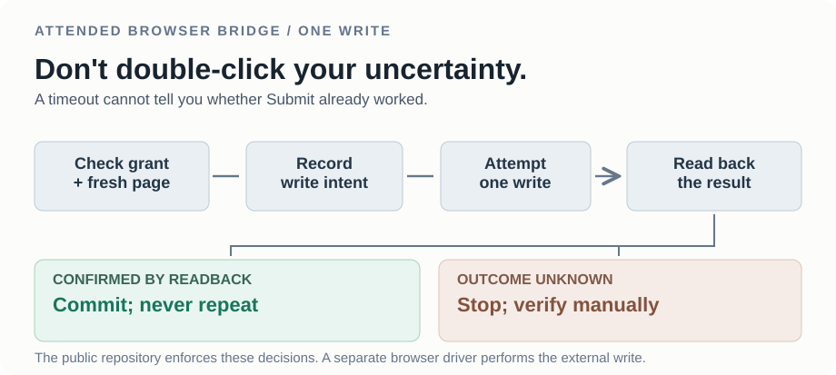

# Attended Browser Bridge

You click **Submit**. The page freezes. Did it go through?

If you click again and it *did* go through, congratulations: you've discovered duplicates.

I built this JavaScript control core for that awkward gap between **“we tried”** and **“we know what happened.”** The exciting part is knowing when *not* to press the button. It isn't a browser driver.

## The one-write rule (the button gets one turn)

| Situation | Decision | Why |
| --- | --- | --- |
| Wrong origin/action, expired grant, or stale page snapshot | **Stop** | Permission for one page isn't permission for its surprise replacement. |
| Already-confirmed effect | **Block duplicate** | The button had its moment. |
| Write was attempted but the result is unknown | **Leave unresolved; block retry** | The page freezing isn't proof the server did nothing. |
| Fresh grant and snapshot, no prior effect | **Record intent; allow one attempt** | The intention exists before the external write. |
| External result independently verified | **Commit that effect** | A readback is stronger than a success message. |

An effect fingerprint and journal distinguish a new request from a duplicate or uncertain prior attempt. A successful authorization check does **not** erase an unresolved write.

## Where the boundaries live

Start with [bridge.js](src/bridge.js), then [policy.js](src/policy.js), [snapshot.js](src/snapshot.js), and [ledger.js](src/ledger.js). The code requires the grant's origin and action to match; page freshness checks include revision, age, and digest.

Node.js 20+; no browser session required to exercise the core. The [verification steps](docs/verification.md), [write-state table](docs/write-state-table.md), and [timeout walkthrough](docs/walkthrough.md) cover permitted writes and blocked replays.

## What this repo cannot do

It cannot click a website, inspect real Chrome cookies, or prove that an external server completed an action. There's no Chrome transport, Kaggle connection, session credential, or deployment in this public repository. A caller must supply the browser integration and a trustworthy external readback.

If the caller can't establish what happened, the correct output is **manual verification required**. I prefer a boring stop to a very exciting duplicate form submission. [Security boundary](SECURITY.md) · [provenance](PROVENANCE.md).
