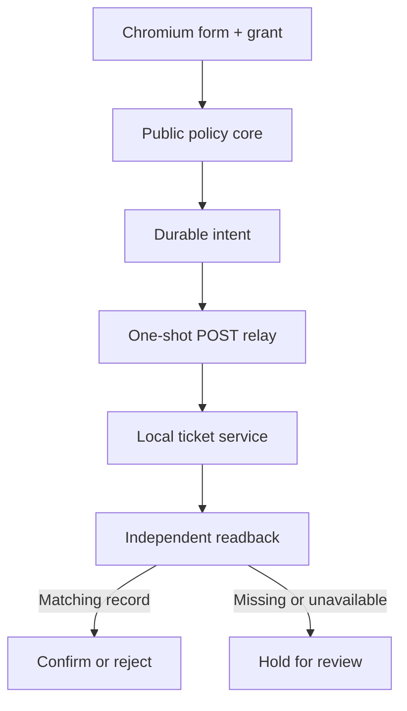

# Architecture sketch

1. Playwright observes the rendered form and submits it only within a valid grant. The core checks freshness and reserves the effect before the action.
2. The adapter rechecks permission and the exact form request, records the dispatch boundary, and relays that request once. The fixture service durably stores the business effect; it can then drop the socket before acknowledgment.
3. A separate read-only lookup resolves a matching saved or rejected record. Absent, mismatched or inaccessible readback stays unresolved. Restarted workers reopen the journal rather than resend.

This is a loopback-only review harness around the actual public control core. It does not distribute the private driver or connect to customer systems.
